# Lyra 기반 맵 생성의 한계와 단일 항공 정사영상 기반 3DGS 전장 구축

## 1. Lyra를 이용한 맵 생성 실패 원인

| 문제 | 구체적인 현상 |
| :--- | :--- |
| **보이지 않는 영역을 임의로 생성** | 입력 사진에 없는 건물 뒷면이나 주변 공간을 생성하면서 없던 성벽·탑 등이 나타남. |
| **긴 영상에서 세부 정보 소실** | 생성이 이어질수록 풀밭 등의 질감이 흐려지고 화면이 밋밋해짐. |
| **실제 거리·높이 유지 실패** | 깊이 추정이 틀어지면서 이동 거리와 고도가 계획과 달라지고, 회차마다 공간의 축척이 달라짐. |
| **재방문 시 장면 불일치** | 같은 장소로 돌아와도 처음과 다르게 생성하여, 하나의 일관된 3D 공간으로 맞추기 어려웠음. |
| **학습하지 않은 시점에서 GS 품질 저하** | 주로 8~25m 높이에서 내려다본 영상으로 학습하여, 약 2m 높이에서는 형상이 깨지고 늘어난 가우시안이 드러남. |

### Lyra 2.0 품질 저하 예시

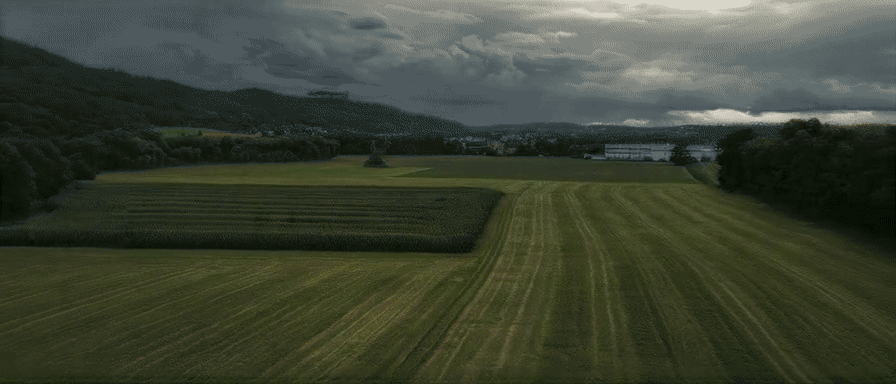

- Lyra 2.0 논문에서도 생성 과정에서 색 변화·흐려짐·왜곡이 누적되어 품질이 점차 저하되는 temporal drifting 문제를 설명함.
- 위 영상에서도 이와 유사한 품질 저하가 관찰되었으며, 맵 생성 방식을 아래 파이프라인으로 변경하여 다시 시도하였음.

> “per-step errors—color shifts, blurring, distortions—go uncorrected and compound across autoregressive steps, gradually degrading quality.”

출처: [Lyra 2.0 논문 §4.3](https://arxiv.org/html/2604.13036v1#S4.SS3)

## 2. 단일 항공 정사영상 기반 3D Gaussian Splatting 전장 맵 생성

### 2.1 입력 데이터

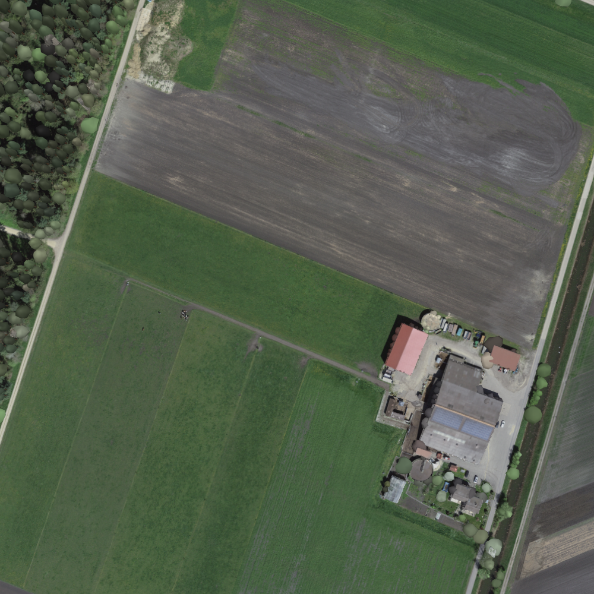

- 중심 맵의 입력으로 스위스 그로세스 모스 지역의 400m × 400m 범위를 담은 정사영상 한 장을 사용.
- 영상의 지상 해상도는 10cm로, 한 픽셀이 지상의 10cm × 10cm 영역에 대응함.
- 맵 외곽에는 별도의 저해상도 주변 영상을 배경으로 사용하였으며, 지면은 높이 0의 평면으로 가정하였음.

### 2.2 사진에서 높이와 물체 종류 추정

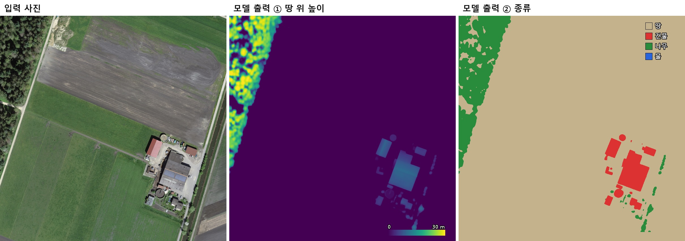

- 정사영상의 각 픽셀에 대해 지면 기준 높이와 land cover(지표 피복 종류)를 동시에 추정. 종류는 땅·건물·나무·물의 네 범주로 구분.
- 이를 위해 Depth Anything V2 Base를 항공영상에 맞게 추가 학습하였음. 먼저 스위스 40km²의 정사영상과 LiDAR 기반 높이 지도를 이용하여 높이 추정을 12,000스텝 학습. 이후 종류 분류 출력을 추가하고, LiDAR 분류 정보를 정답으로 사용하여 8,000스텝 추가 학습. 시험 지역과 그 둘레 3km는 학습 대상에서 제외하였음.
- LiDAR는 모델의 학습용 정답으로 사용. LiDAR 정답이 없는 입력 영상에서도 맵을 생성할 수 있도록, LiDAR 정답이 있는 영상들로 높이와 종류를 추정하는 모델을 학습하였음.

### 2.3 높이·종류 지도를 3D 물체로 변환

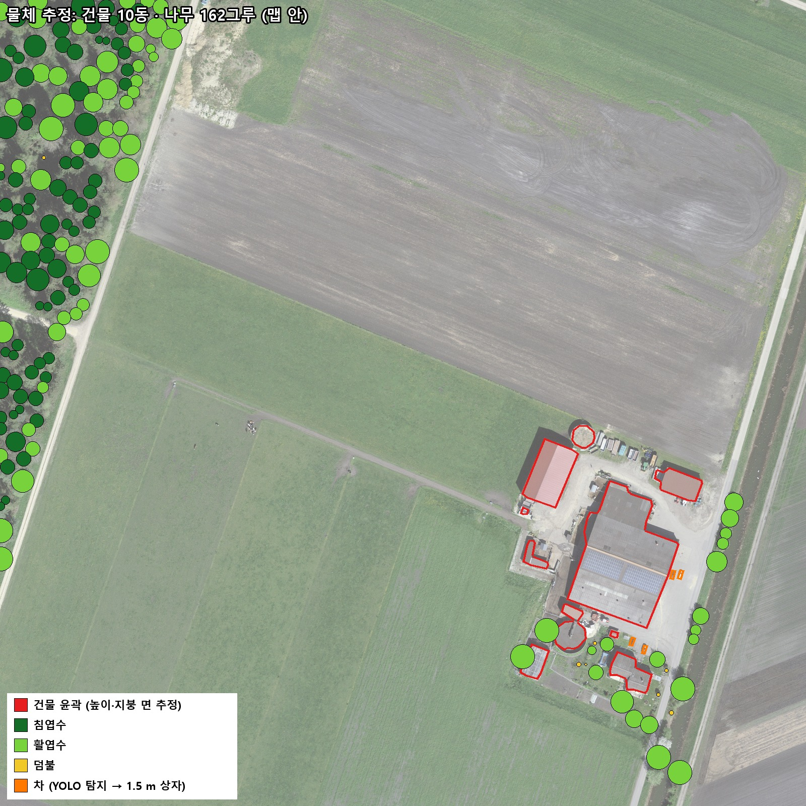

추정 결과를 이용하여 건물·나무·차량의 형상과 배치를 결정.

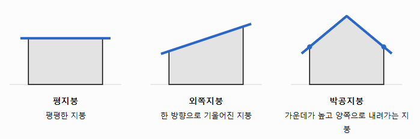

- **건물:** 건물로 분류되고 높이가 1m 이상인 영역에서 외곽선을 추출. 내부 높이값에 평지붕·외쪽지붕·박공지붕을 각각 맞추고, 오차를 비교하여 지붕 형태를 선택. 예를 들어 건물 양끝보다 가운데의 추정 높이가 높으면 박공지붕 후보로 해석하고, 각 지붕 모델의 오차를 비교하여 최종 형태를 결정.
- **나무:** 나무 영역의 높이 지도에서 국소 봉우리를 찾아 나무의 위치와 키를 결정. 이웃 나무와의 거리로 수관 크기(가지와 잎이 옆으로 퍼져 있는 범위)를 정하고, 높이·색상·형태 규칙에 따라 덤불·침엽수·활엽수로 구분하였음.
- **차량:** 항공영상용 YOLO11l-OBB로 회전된 차량 영역을 탐지. 탐지한 차량 4대는 높이 1.5m의 상자로 표현하였음.

### 2.4 지면에 남은 물체 이미지 제거

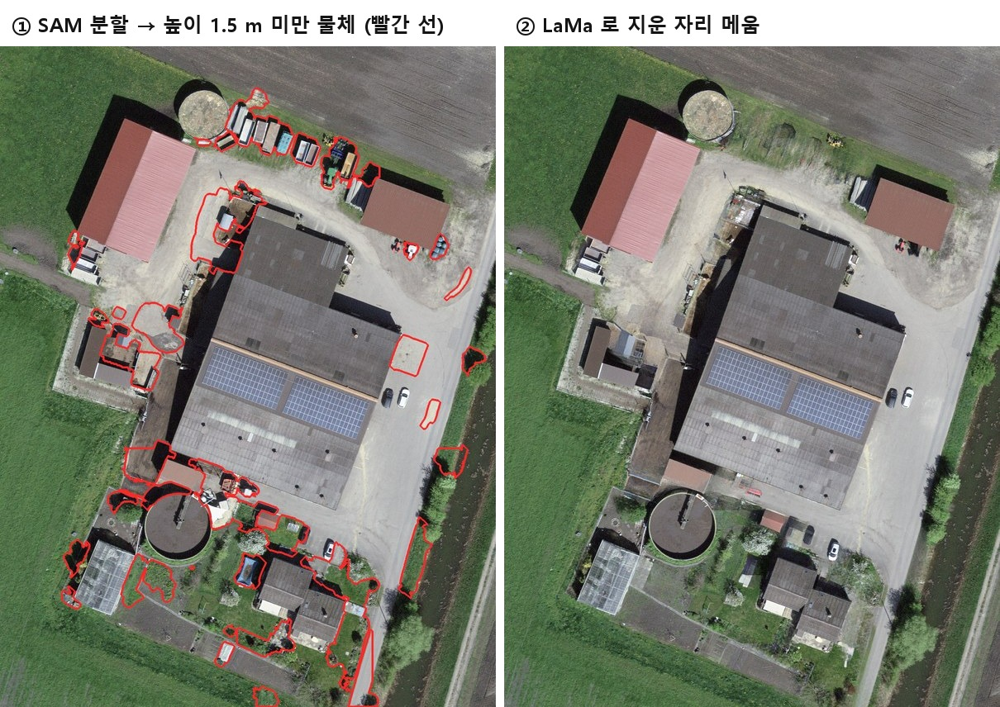

- 높이가 충분히 추정되지 않은 낮은 물체는 지면 텍스처에 납작한 그림처럼 남게 됨. 이러한 영역을 정리하기 위해 SAM으로 건물 주변을 분할하고, 면적·추정 높이·피복 분류·주변 색상 차이 등의 규칙으로 제거 대상을 선별.
- 선별한 영역과 그림자는 LaMa로 주변 지면과 자연스럽게 이어지도록 메웠음. 총 95개 영역, 2,098m²를 처리하였음.
- 더 작은 물체까지 표현하려면, SAM이 감지한 물체의 종류를 VLM(Qwen3-VL)으로 판단한 뒤 YOLO 라벨로 저장하고, 이를 이용해 YOLO를 추가 학습하는 방식을 시도할 수 있음.

### 2.5 정사영상에서 관측하기 어려운 건물 벽면 보완

건물 형상은 공통으로 유지하고, 벽면의 외관을 구성하는 방법만 버전별로 다르게 적용.

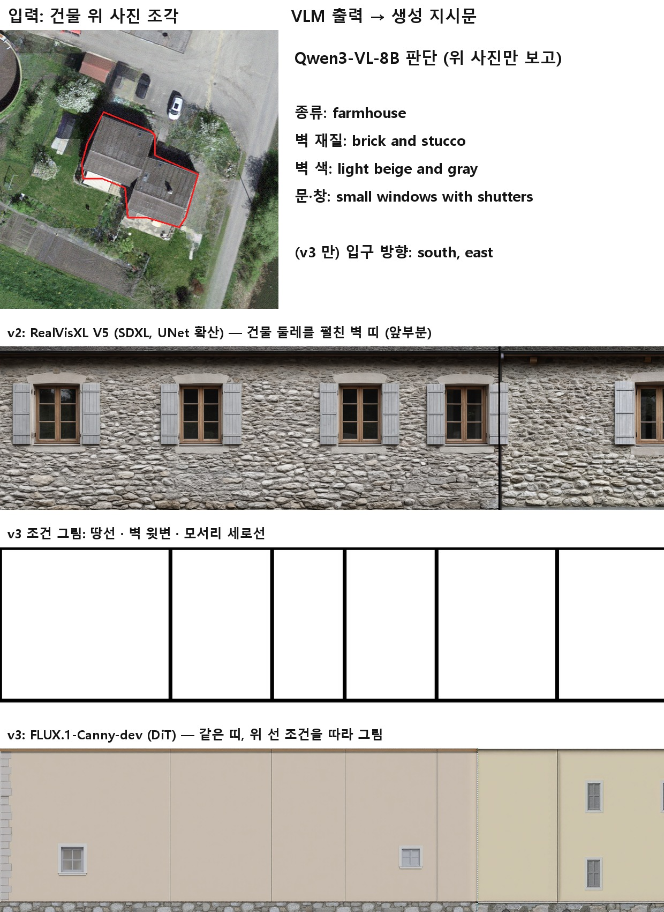

| 버전 | 벽면 구성 방법 |
| :---: | :--- |
| v1 | 면적 규칙에 따른 기본 재질 적용 |
| v2 | VLM과 SDXL을 이용한 벽면 텍스처 생성 |
| v3 | VLM과 FLUX를 이용한 벽면 텍스처 생성 |

- 세 버전은 동일한 맵 구축 과정을 공유하며, 벽면 텍스처 생성 방식에서 차이가 발생함.
- v1은 기존 버전, v3는 서현 학생과 논의하여 진행한 버전, v2는 v3에서 이미지 생성 모델만 바꿔 진행한 버전임.

### 2.6 Blender 장면 조립

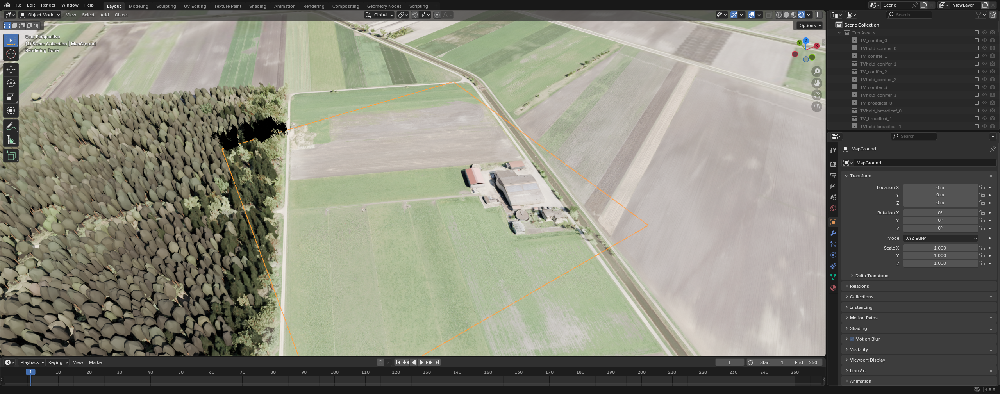

- 앞 단계에서 얻은 물체 형상과 텍스처를 Blender 장면에 배치. 지면에는 정리된 정사영상을 적용하고, 풀·흙·자갈의 근거리 질감을 추가. 지붕에는 정사영상 색상과 기와 재질의 요철을, 벽에는 버전별로 준비한 텍스처를 적용하였음.
- 나무는 Infinigen으로 미리 생성한 9종의 모델을 이용.
- 전체 3,835그루 중 맵 내부와 촬영 위치에서 보이는 주변 나무 등 595그루에는 상세 모델을 적용하고, 나머지에는 단순한 모델을 사용하여 최적화하였음.
- Nishita 하늘 모델을 적용하고 태양의 고도와 방위를 각각 38°와 160°로 설정.

### 2.7 Blender 장면에서 다중 시점 학습 영상 생성

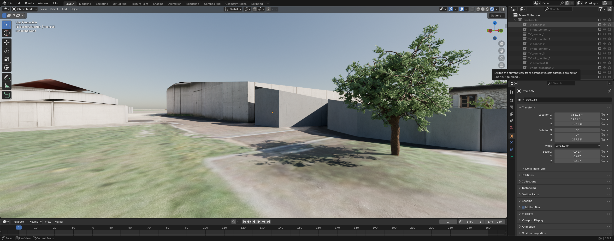

- 완성된 장면을 지상 144곳과 상공 36곳, 총 180곳에서 가상 촬영. 지상 촬영 높이는 2m, 상공 촬영 높이는 25~35m로 설정하여 지면 주변과 지붕·수관 윗면을 함께 관측하도록 하였음.
- 각 위치에서 360° RGB 파노라마와 물체까지의 거리를 기록한 깊이 영상을 렌더링하였음.
- 이후 파노라마마다 60° 간격의 여섯 방향을 원근 영상으로 변환하여 총 1,080쌍의 RGB·깊이 영상을 생성. 즉, 180개 위치 × 6개 방향 = 1,080개 시점임.
- 원근 영상의 해상도는 720 × 405, 수평 시야각은 90°로 설정하였으며, 하늘은 투명하게 렌더링하였음.

이 단계는 구성된 3D 장면을 3DGS 학습에 사용할 다중 시점 관측 데이터로 변환하는 과정임.

### 2.8 3D Gaussian Splatting 학습과 맵 출력

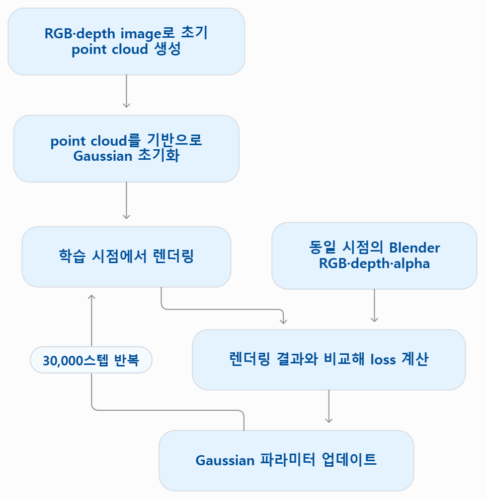

- 깊이 영상의 각 픽셀을 3차원 공간으로 역투영하여 색상을 가진 초기 포인트 클라우드를 생성.
- 이를 시작점으로 gsplat을 이용해 30,000스텝 동안 가우시안의 위치·크기·방향·색상·투명도를 최적화하였음.

| 손실 | 설명 |
| :--- | :--- |
| **Photometric loss** | GS로 렌더링한 영상이 Blender 영상과 비슷한 색과 모습을 갖도록 함. |
| **Alpha loss** | 하늘 부분에 불필요한 가우시안이 진하게 나타나지 않도록 함. |
| **Inverse depth loss** | 물체가 기준 영상과 비슷한 거리에 나타나도록 함. |

## 3. 전체 흐름 다이어그램

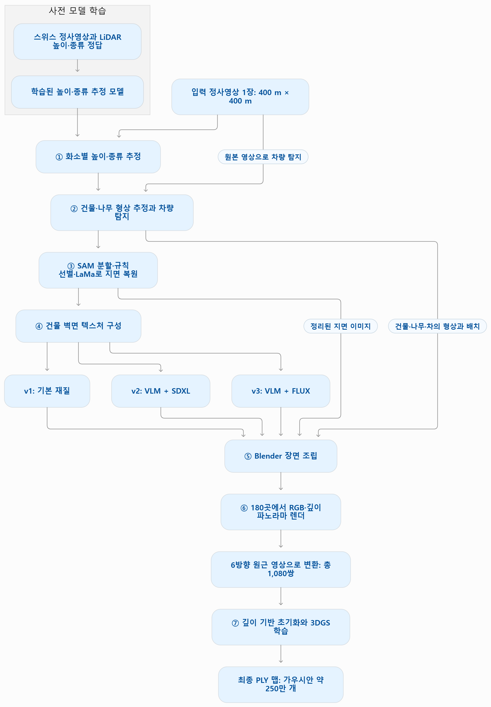

## 4. 버전별 맵 전경 비교

| v1(Rule) | v2(SDXL) | v3(FLUX) |
| :---: | :---: | :---: |
| 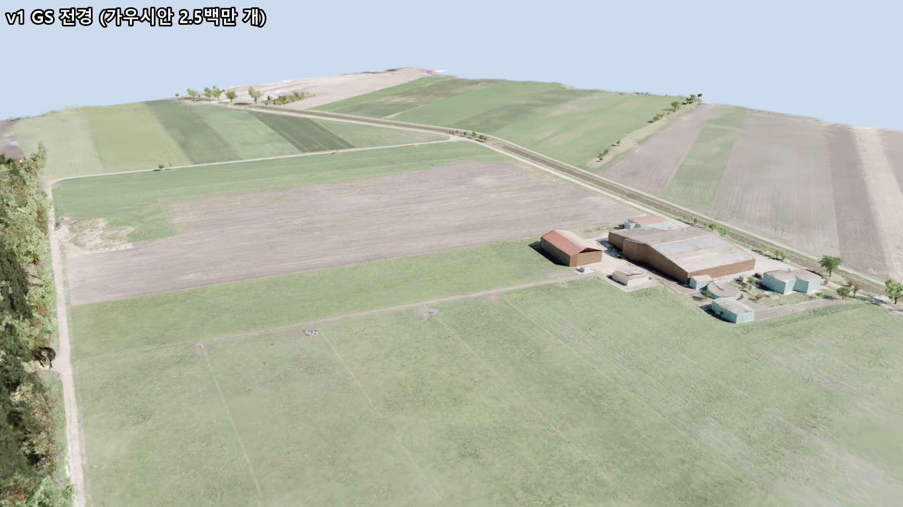 | 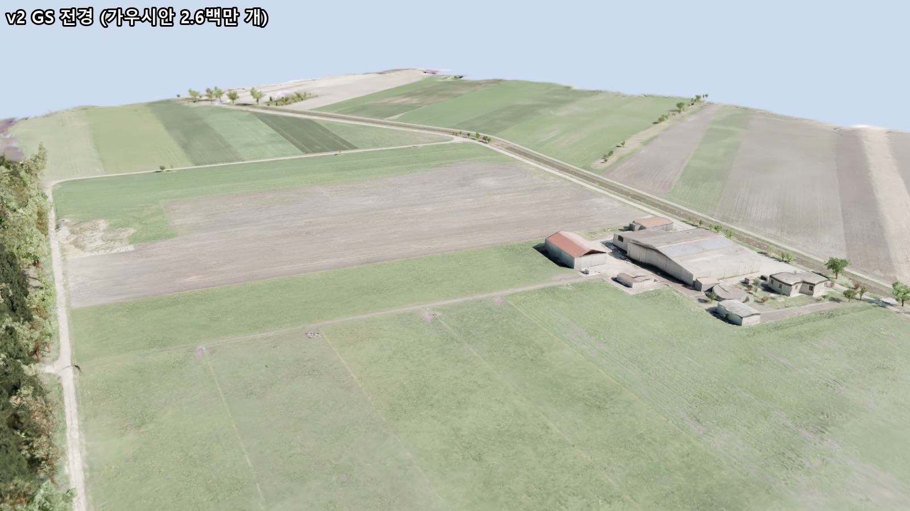 | 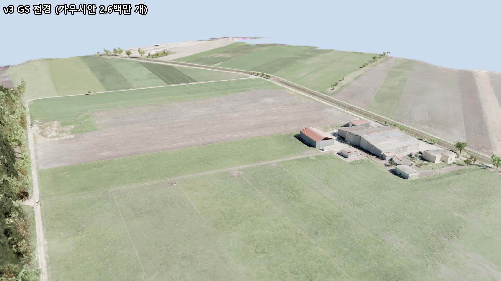 |

- v1은 모델 없이 **건물 크기 하나만 보고 재질 세 가지 중 하나를 고르는** 간단한 규칙을 사용하였음.
- FLUX는 파라미터 약 120억으로, SDXL(약 26억)의 약 4~5배임.
- 현재 맵에서는 건물 옆면 품질에 큰 차이가 관찰되지 않아 SDXL(v2)로 진행하였음.

## 5. 학습 모델 전투

https://github.com/user-attachments/assets/38255f08-f946-4de4-980e-522e9d709afe

- 현재는 건물이나 나무에 충돌 판정을 적용하지 않고, 맵을 시각적 배경으로만 사용.
- 궤도 주행, 땅과의 접촉, 전차 간 충돌, 전장 경계벽, 포탑·포신 관절 회전 등의 물리 계산은 Genesis Physics Solver에서 담당.
- 전차는 Objaverse에 포함된 Sketchfab 공개 3D 모델인 KF51을 사용.
- 왼쪽 녹색 전차는 평지 지형에서 강화학습을 완료한 MARL 모델로 제어됨.
