# 국내 드론 영상 기반 주행 맵 생성 진행 상황

## 1. 입력 데이터 변경: 덴마크 항공영상 → AI Hub 제주 드론 영상

| 항목 | 11-06 (덴마크 오르후스) | 현재 (제주 누웨마루) |
| :--- | :--- | :--- |
| 자료 | 덴마크 공개 항공영상 | AI Hub 자율주행 드론 영상 |
| 영상 수 | 25장 (동·서·남·북 45° 경사 + 수직) | 602장 (45° 경사 402장 + 수직 200장, 고도 약 100 m) |
| 카메라 위치·자세 | 자료에 포함 | 영상별 GPS 위치만 포함 (카메라 방향·렌즈 값 없음) → COLMAP으로 복원 |
| 맵 범위 | 400 m × 400 m | 400 m × 300 m |

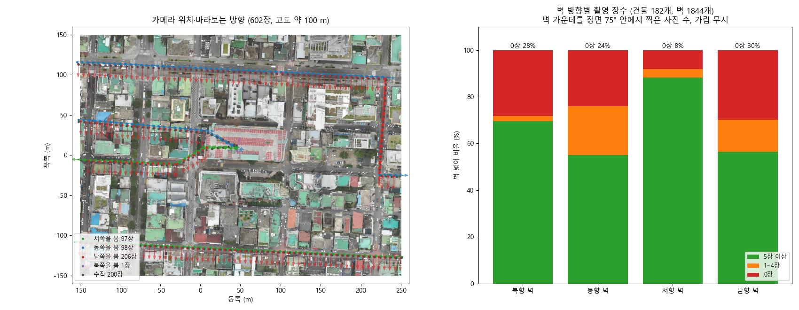

- 왼쪽 그림의 점은 카메라 위치, 화살표는 카메라가 바라보는 방향
- 드론이 동서 방향으로 비행하며 대부분 남쪽이나 바로 아래를 보고 촬영. 북쪽을 보고 찍은 영상은 602장 중 1장뿐
- 그 결과 건물 남쪽 벽은 거의 찍히지 않음. 오른쪽 그림처럼 남향 벽의 30 %, 전체 벽의 23 %가 영상에 한 번도 나오지 않음
- 영상에 없는 벽은 형상과 색을 모두 생성 모델이 만들어야 하는 부분

## 2. 전체 파이프라인

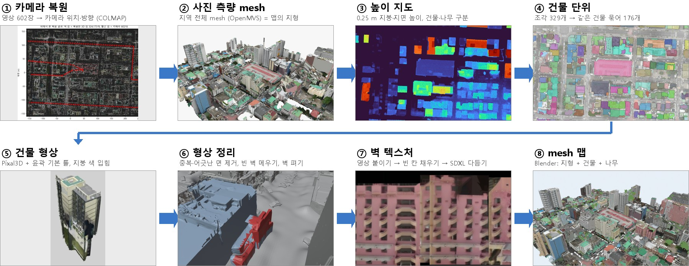

### 2.1 카메라 복원 · 사진 측량 mesh · DSM/DTM

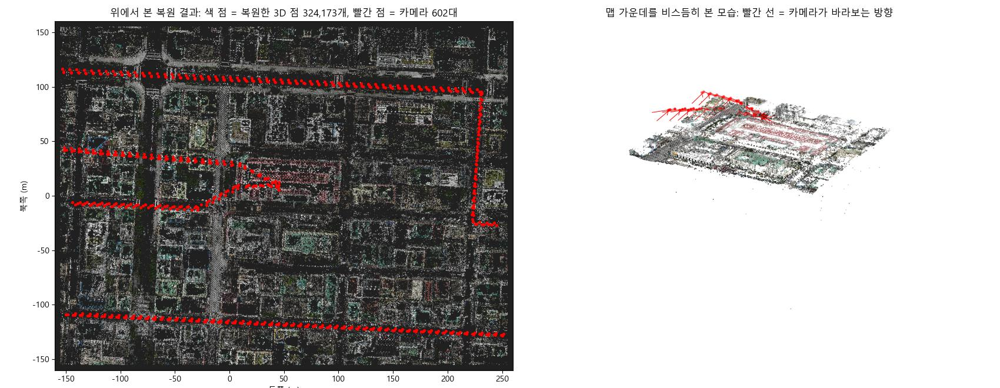

- **카메라 복원 (COLMAP)**: 여러 영상에서 같은 점을 찾아 카메라 위치·방향과 3D 점을 함께 계산하는 SfM(Structure-from-Motion) 프로그램. 겹치는 영상 쌍 15,902개에서 같은 점을 맞춰 602장 모두의 카메라 복원. 계산한 3D 점을 영상에 다시 찍었을 때 실제 특징점 위치와의 차이는 평균 0.84픽셀
- **실제 크기·위치 맞춤**: 영상만으로는 실제 크기를 알 수 없어(실물과 축소 모형을 찍은 영상은 같아 보임), AI Hub 라벨에 있는 영상별 드론 GPS 위치에 맞춰 크기·회전·위치 결정. 복원한 카메라와 GPS 위치의 차이는 중앙값 3.0 m (드론 GPS 자체 오차 포함)

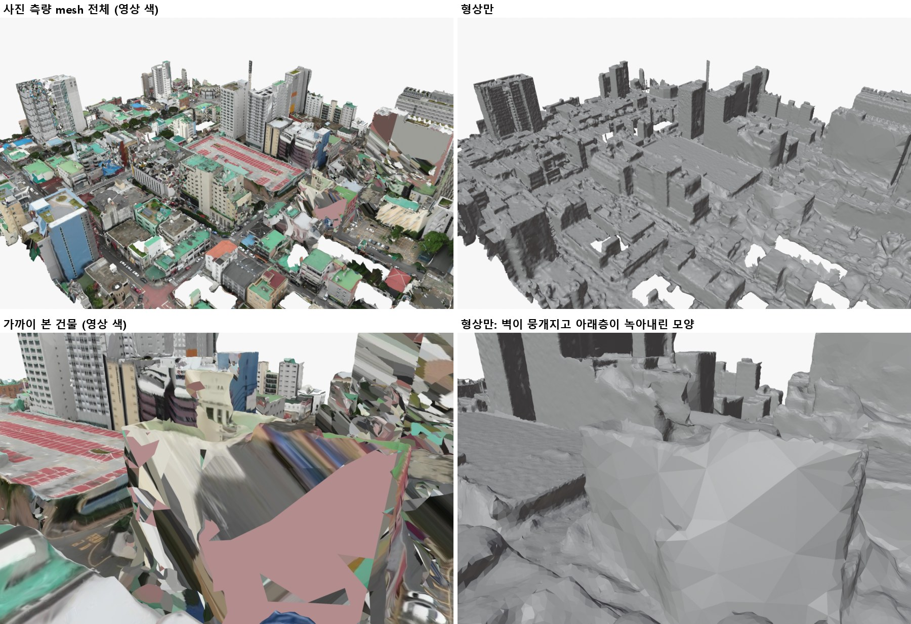

- **사진 측량 mesh (OpenMVS)**: 복원한 카메라로 지역 전체 mesh 생성 (400 m × 300 m, 50 m 타일 48개). 도로·마당 등 지형은 이 mesh를 그대로 맵에 사용
- 건물은 아래 줄처럼 벽이 뭉개지고 아래층이 녹아내린 모양이라 따로 생성 (2.3)

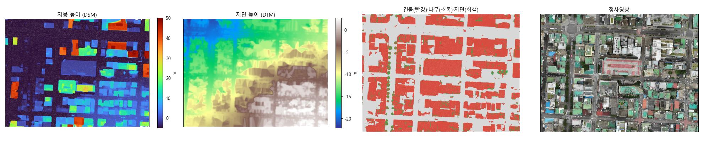

- **DSM (Digital Surface Model, 수치표면모델)과 DTM (Digital Terrain Model, 수치지형모델)**: 맵을 위에서 내려다보고 25 cm × 25 cm 칸으로 나눈 뒤, 칸마다 높이를 하나씩 적은 표. 카메라에서 물체까지의 거리를 담은 depth map과 달리, 위에서 본 높이
  - DSM: 그 자리에서 가장 높은 곳의 높이. 건물 위면 지붕 높이, 길 위면 길 높이
  - DTM: 건물·나무를 걷어 낸 땅의 높이
  - DSM − DTM = 그 자리에 서 있는 물체의 높이. 2.5 m 이상이면 건물, 초록색이면서 표면이 거칠면 나무로 구분
- 이후 단계에서의 쓰임: 건물 찾기(물체 높이), 기본 틀(땅부터 지붕까지의 높이), 생성한 건물의 지붕 높이 검사, 벽 가림 판정(카메라에서 벽까지 그은 선이 중간 건물에 막히는지)

### 2.2 건물 단위 나누기

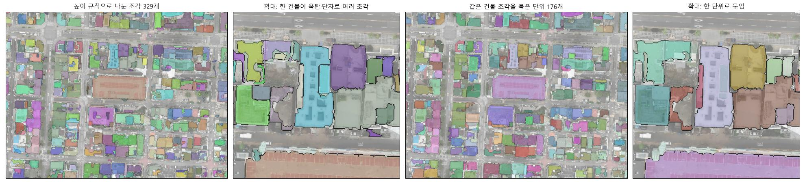

- DSM − DTM이 2.5 m 이상이고 나무가 아닌 영역을 건물로 보고, 지붕 높이가 1.5 m 이상 바뀌는 곳에서 나눔 → 조각 329개
- 문제: 옥탑이나 지붕 단차가 별도 조각으로 떨어져 나옴 (두 번째 그림). 조각마다 따로 생성하면 같은 건물을 두 번 만드는 셈 (3.1 ②)
- 해결: 작은 조각(150 m² 미만)이 옆 조각과 같은 건물인지 드론 사진으로 확인. SAM 2.1(사진에서 물체를 오려 내는 모델)로 사진을 나눴을 때 두 조각이 한 물체로 함께 오려진 사진이 90 % 이상이고 지붕 높이 차가 8 m 미만이면 같은 건물로 합침 → 건물 단위 176개 (네 번째 그림)

### 2.3 건물 형상 생성 (Pixal3D)

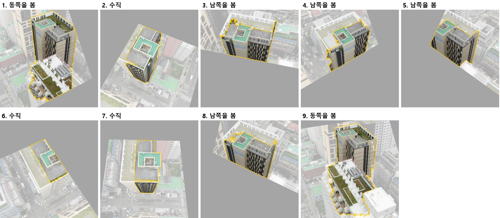

- **입력 영상**: 건물이 절반 이상 보이는 영상 중 바라보는 방향이 서로 먼 순서로 최대 9장 선택. 각 영상은 건물 중심을 바라보도록 회전시킨 가상 카메라 영상으로 바꾸고, 건물 마스크(노란 선)는 SAM 2.1로 생성 (건물 윤곽을 영상에 투영한 상자와 지붕 중심점을 입력으로 사용)

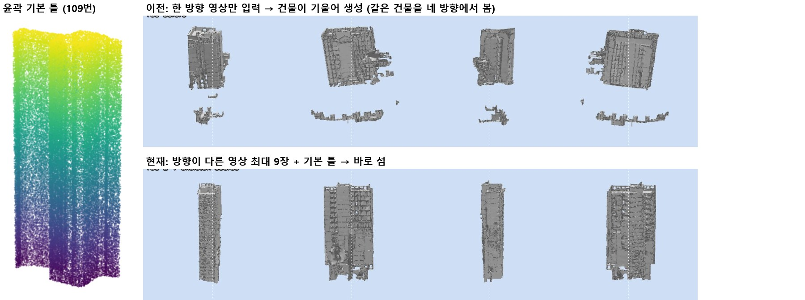

- **윤곽 기본 틀**: 윤곽 안 0.25 m 칸마다 땅부터 지붕까지 기둥을 세워 만든 건물 덩어리(왼쪽)를 Pixal3D 첫 단계(32³ 격자)에 반영. 틀 밖에 생긴 칸은 지우고, 모델이 비워 둔 틀 겉면 칸은 채움

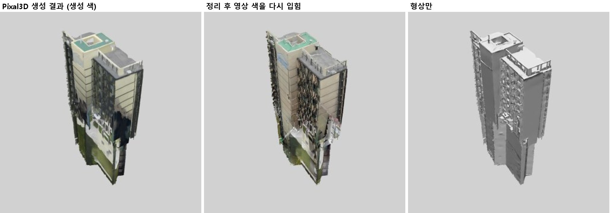

- **정리·판정**: 떠 있는 작은 조각과 땅 아래 면을 지우고 벽 밑을 땅까지 내림. 벽 구멍과 지붕 높이(DSM과 비교)를 검사해 후보 중 가장 나은 결과 선택
- **지붕 색**: 칸마다 그 칸이 보이는 영상들의 중앙값으로 전체 색을 정하고, 가장 정면에서 본 영상으로 세부 무늬를 더함 (가운데). 지붕은 위에서 잘 찍혀 이 색을 그대로 사용
- **이번 맵의 적용 범위**: 단위 묶기와 기본 틀을 넣은 새 방식은 소규모 실험으로 25개 단위만 다시 생성. 나머지 133개 단위는 Pixal3D를 다시 돌리지 않고, 처음 맵을 만들 때 조각별로 생성해 둔 결과를 단위로 모은 뒤 2.4의 규칙(중복 제거, 어긋난 면 제거, 벽 펴기)으로 보완
- 향후 전체 건물을 새 방식으로 다시 생성해 맵 전체에 적용 예정

### 2.4 형상 정리 (재생성 없이)

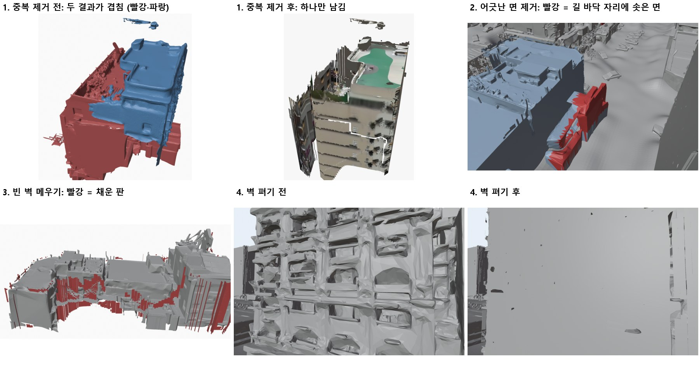

| 순서 | 하는 일 | 기준 |
| :---: | :--- | :--- |
| 1 | 중복 결과 제거 | 한 단위에 결과가 여럿이고 바닥 범위가 50 % 넘게 겹치면, 지붕 높이가 DSM과 더 잘 맞는 결과 하나만 남김 |
| 2 | 어긋난 면 제거 | 윤곽 밖 1 m 넘는 곳에서 DSM보다 1.5 m 넘게 솟은 면, 또는 길·마당 위에 솟은 면 삭제. 삭제 후 떨어져 남은 작은 조각도 삭제 |
| 3 | 빈 벽 메우기 | 윤곽 벽선에서 mesh가 없는 자리를 0.25 m 크기 판으로 채움 |
| 4 | 벽 평면으로 펴기 | 윤곽(1 m 단위로 단순화)에 가까운 면을 벽 평면으로 당김. 영상이 있는 칸은 1.6 m 안, 영상이 없는 칸은 3 m 안까지. 지붕 면은 제외 |

### 2.5 벽 텍스처

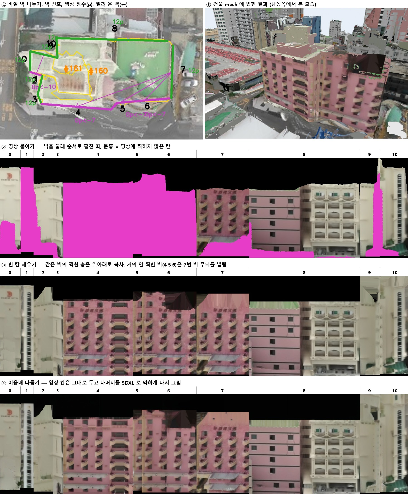

160번 단위(분홍 건물과 크림색 건물이 붙은 단위)의 단계별 결과. 띠 그림 위 숫자는 왼쪽 위 그림의 벽 번호이며, 건물 158개 단위 전체에 같은 방법 적용

1. **바깥 벽 나누기**: 건물 윤곽을 1 m 단위로 단순화하고, 2 m 이상인 변마다 땅부터 지붕까지 벽 평면 배치. 벽 높이는 윤곽 1~2 m 안쪽의 지붕 높이
2. **영상 붙이기**: 벽 평면을 5 cm 칸으로 나누고, 각 칸이 보이는 영상에서 색을 가져옴. 칸이 영상 밖이거나, 다른 건물에 가려져 있거나(DSM으로 판정), 75° 넘게 비스듬히 찍혔으면 제외. 영상이 1~2장뿐이면서 모두 70° 넘게 비스듬한 칸도 제외. 영상마다 밝기를 맞춘 뒤 정면에 가깝고 가까이서 찍은 영상을 우선해 섞음. 분홍 칸이 영상에 찍히지 않은 칸이며, 이 단위에서는 남쪽 벽(4·5·6번)이 통째로 비어 있음
3. **빈 칸 채우기**
   - 일부만 찍힌 벽: 같은 벽의 찍힌 층을 위아래로 복사. 건물 벽은 같은 층이 일정한 높이마다 반복되므로(예: 3 m마다 창문 줄), 벽 그림의 가로줄별 밝기를 위에서 아래로 늘어놓고, 이를 조금씩 밀어 가며 원래와 가장 잘 겹치는 거리를 층 높이로 사용 (층 높이로 있을 법한 2.6~4.5 m 안에서 탐색)
   - 거의 찍히지 않은 벽: 같은 건물에서 창 무늬가 규칙적이고 밝기·높이가 비슷한 가까운 벽을 빌림 (4·5·6번 벽 ← 7번 벽)
   - 이웃 건물에 붙어 가려진 칸: 위층 무늬를 이어 복사
4. **이음매 다듬기**: 벽을 둘레 순서로 펼친 띠에서 잘 찍힌 영상 칸은 그대로 두고, 나머지를 SDXL 인페인팅(inpainting)으로 약하게(세기 0.4) 다시 그림. 같은 건물의 잘 찍힌 벽을 IP-Adapter 참고 이미지로 넣어 색과 무늬를 건물에 맞춤
5. **mesh에 입히기**: 벽 평면 가까이에 있는 mesh 면에 벽 텍스처를 입힘. 벽과 직각인 옆면(발코니 옆 등)은 텍스처가 세로로 늘어나지 않도록 옆으로 펼쳐 붙임. 지붕은 2.3의 지붕 색을 유지하고, 바깥 벽도 지붕도 아닌 면은 가장 가까운 벽의 바탕색으로 칠함

### 2.6 Blender 맵 조립

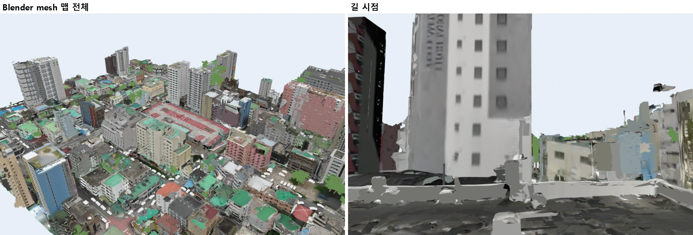

- 사진 측량 지형 타일(건물 자리는 잘라냄), 건물 mesh, 나무를 Blender 장면에 배치
- 조립은 Blender Python 스크립트로 자동화. Blender를 화면 없이 명령줄(background 모드)로 실행하며 수작업 없음
  - 처음 맵: 지형 타일·건물 mesh·나무(DSM에서 찾은 위치와 높이)를 배치하는 스크립트로 생성
  - 갱신: 이전 맵 파일을 열고 바뀐 건물을 지운 뒤 새 건물 mesh를 불러와 저장하는 스크립트. 한 번에 1~8분

### 2.7 직전 보고 대비 바뀐 점

| 단계 | 11-06 | 현재 | 바꾼 이유 |
| :--- | :--- | :--- | :--- |
| **건물 나누기** | 지도·OSM 건물 윤곽 | DSM으로 나누고 같은 건물 조각을 묶음 | 국내는 OSM 윤곽이 부족하고, 한 건물이 여러 조각으로 나뉘면 두 번 생성됨 |
| **입력 영상** | 방향별 45°에 가까운 영상 3장 | 방향이 먼 순서로 최대 9장, 일부만 보이는 영상 포함 | 덴마크 방식으로 고르면 한 방향 영상만 남아 건물이 기울어 생성됨 |
| **텍스처** | Pixal3D 텍스처 위에 영상 색을 다시 입힘 | 바깥 벽마다 텍스처를 따로 만들어 입힘 | 영상이 없는 벽에서 생성 텍스처가 얼룩·조각처럼 보임, 즉 Pixal3D는 mesh만 생성하는 역할 |

## 3. 문제: 맵에서 건물이 조각나 보임

### 3.1 원인과 해결

| 원인 | 구체적인 현상 | 해결 |
| :--- | :--- | :--- |
| **영상이 없는 벽을 생성 모델이 만듦** | Pixal3D가 남쪽 벽 등을 울퉁불퉁한 덩어리와 얼룩진 색으로 만듦 | 영상이 없는 벽은 평평하게 펴고, 같은 건물의 찍힌 벽 무늬로 텍스처를 다시 만듦 |
| **같은 건물을 두 번 생성** | 두 결과가 겹쳐서 표면이 섞여 보임 | 건물 단위마다 지붕 높이가 실제와 더 잘 맞는 결과 하나만 남김 |
| **실제로 없는 덩어리** | 건물 옆 길·마당 쪽으로 덩어리가 튀어나옴 | DSM에서 길·마당으로 나온 자리에 솟은 면을 제거 |
| **건물 안쪽 단차 벽의 텍스처** | 높은 동과 낮은 지붕 사이의 벽, 두 동 사이 홈 등에 바깥 벽 텍스처가 비스듬히 찍혀 찢어져 보임 | 현재는 가장 가까운 벽의 바탕색 한 가지로 칠함. 이후 단차 벽도 벽으로 인식하도록 개선 예정 |

#### ① 영상이 없는 벽을 생성 모델이 만듦

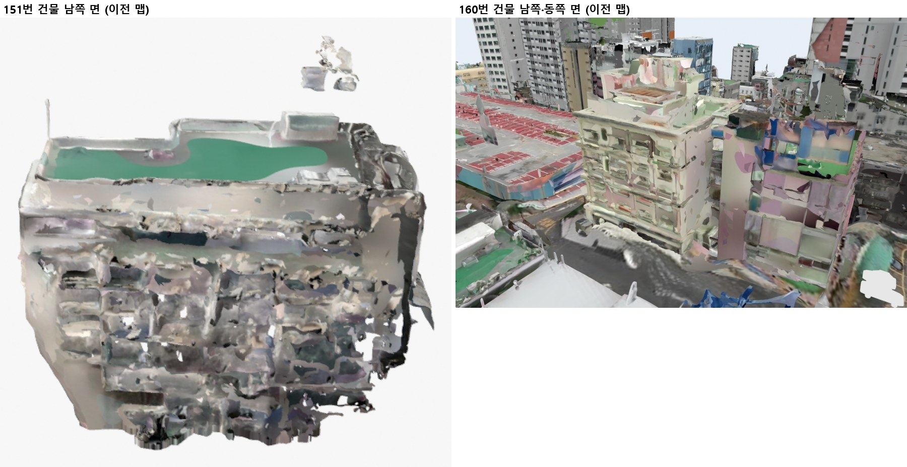

- 두 건물 모두 영상이 없는 남쪽 면. Pixal3D가 지어낸 울퉁불퉁한 형상 위에 얼룩진 색이 입혀져 조각나 보임

#### ② 같은 건물을 두 번 생성

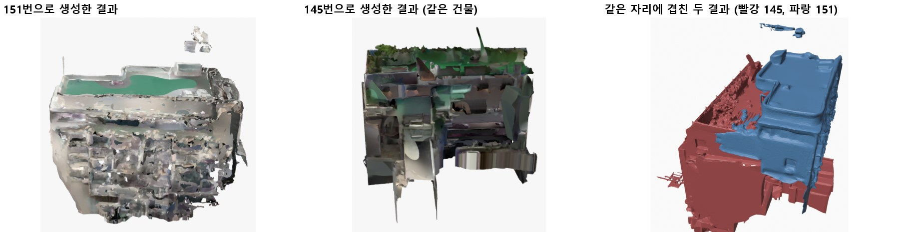

- 151번과 145번은 지붕 높이 차이로 나뉜 같은 건물의 조각. 각 조각에서 건물 전체를 생성해, 맵의 같은 자리에 두 결과가 서로 파고들며 겹침 (오른쪽: 빨강 145, 파랑 151)

#### ③ 실제로 없는 덩어리

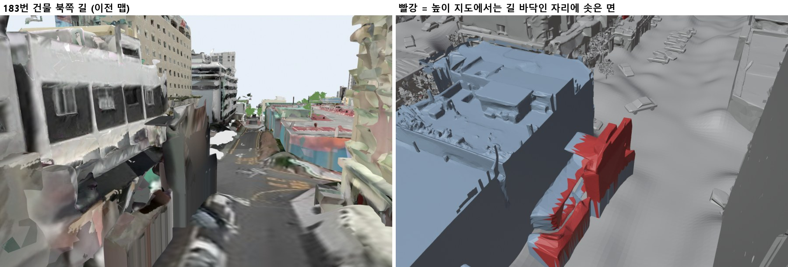

- 앞 건물에 가려 영상에 보이지 않는 벽 아래쪽을 Pixal3D가 덩어리로 만들었고, 그 덩어리가 길 쪽으로 튀어나옴

#### ④ 건물 안쪽 단차 벽의 텍스처

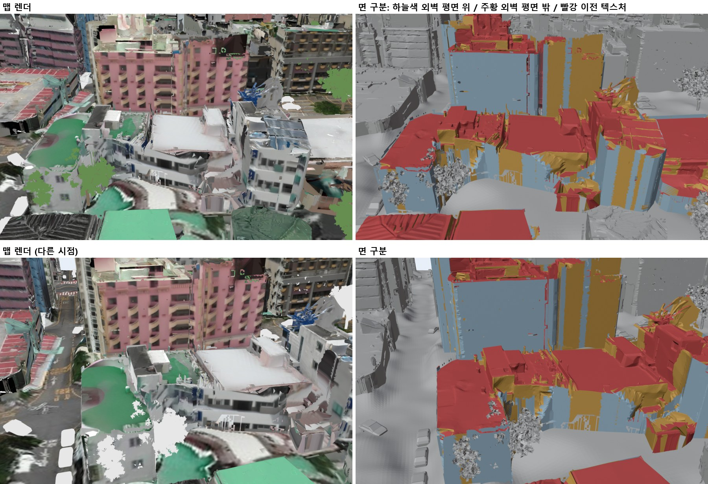

- 오른쪽 그림의 하늘색은 바깥 벽에 정상적으로 붙은 텍스처, 주황은 바깥 벽이 아닌 곳에 비스듬히 붙은 텍스처, 빨강은 이전 생성 텍스처가 남은 면
- 조각나 보이던 부분은 주황·빨강이 섞인 자리로, 생성 모델이 그린 결과가 아니라 텍스처를 붙이는 단계에서 생긴 문제

### 3.2 결과

#### 영상이 없는 남쪽 벽 (160번 건물)

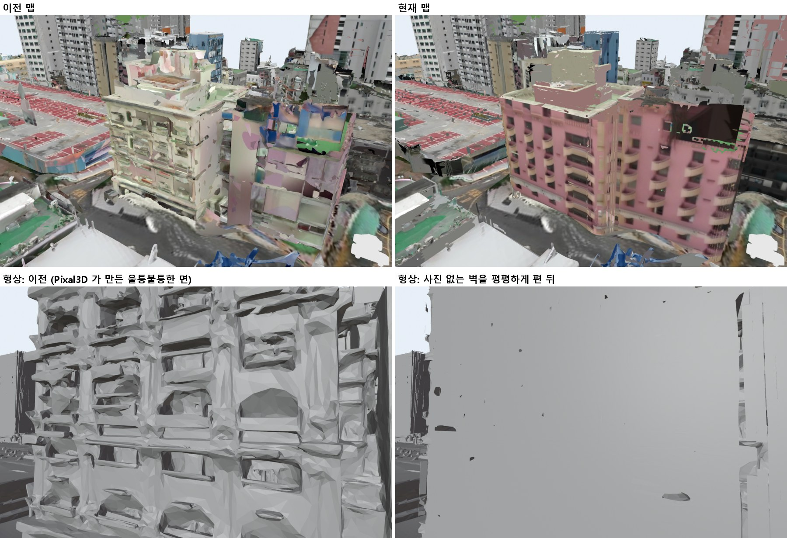

- 이전 맵은 남쪽 벽이 생성 모델이 만든 얼룩과 덩어리였으나, 현재는 같은 건물의 찍힌 벽 무늬(분홍 벽과 발코니)로 이어 붙임
- 아래 줄은 텍스처 없이 형상만 표시한 것으로, 울퉁불퉁하던 벽면이 평평해짐
- 창문 같은 detail은 mesh가 아닌 texture로 표현할 것이기에 넣은 파이프라인

#### 실제로 없는 덩어리 제거 (183번 건물 북쪽 길)

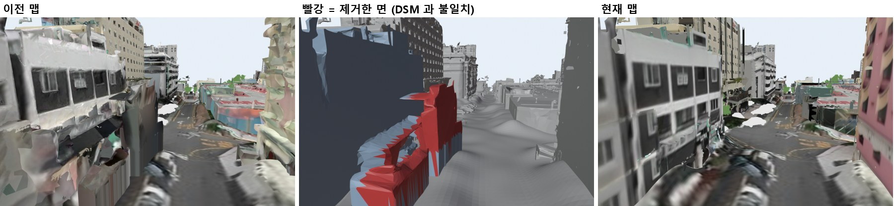

- 가운데 그림의 빨간 부분이 제거한 면. DSM에서는 길 바닥인데 mesh에는 덩어리가 솟아 있던 자리

#### 건물 안쪽 단차 벽

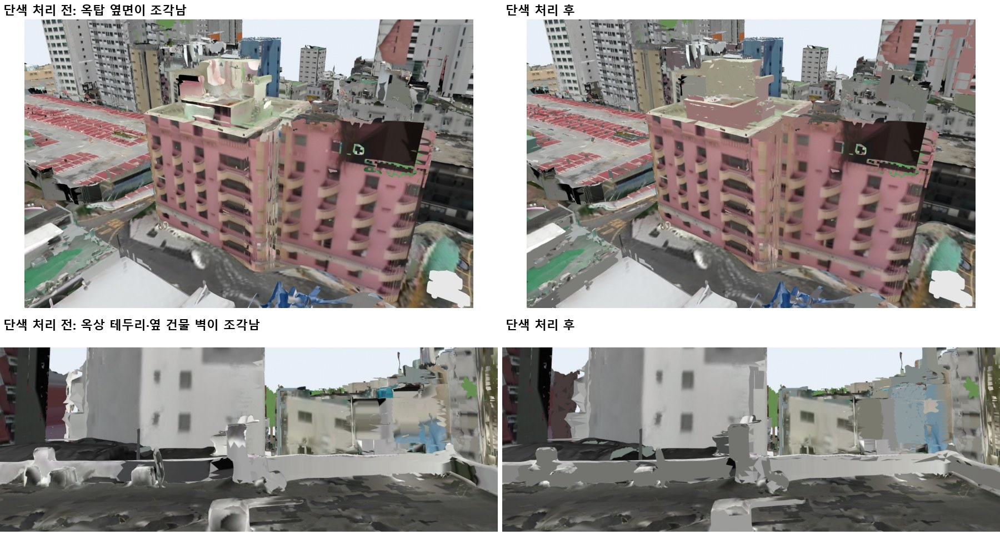

- 이 면들을 가장 가까운 벽의 바탕색으로 칠해 조각 제거

## 4. 현재 맵

### 전체

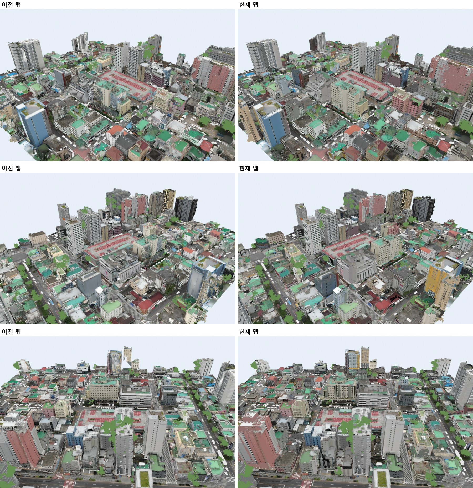

### 로드뷰

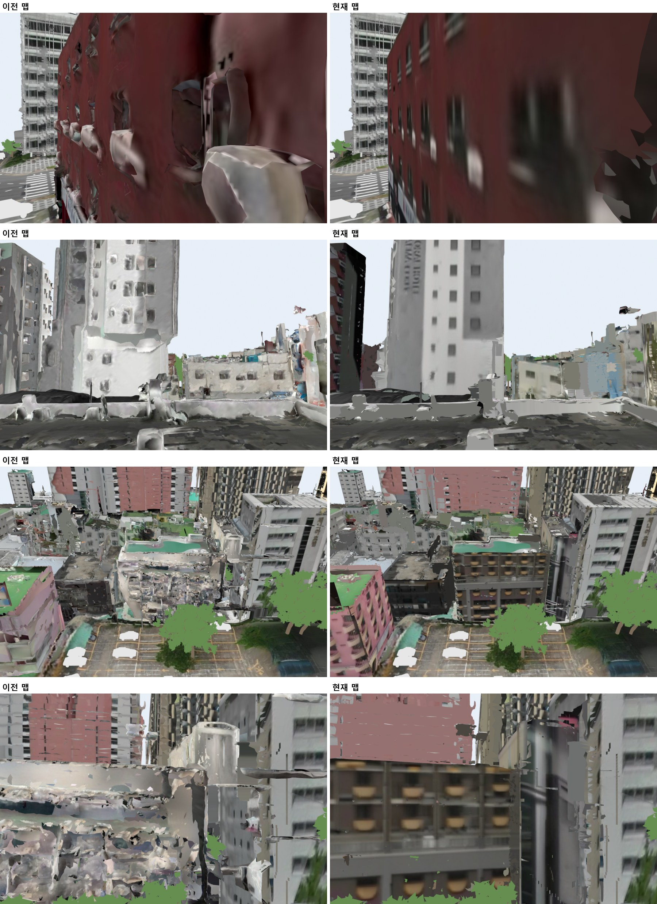

- 건물 158개 단위 전체에 적용. 길 시점은 영상이 거의 없는 건물 남쪽에서 본 모습

### 영상 (왼쪽 이전 맵, 오른쪽 현재 맵)

맵 상공 한 바퀴

https://github.com/user-attachments/assets/135edcc8-dd5c-4a57-b770-4842055f397e

183번 건물 북쪽 길, 지면 위 2.5 m

https://github.com/user-attachments/assets/d1150e3b-419d-4159-899b-bc065ac24ff2

## 5. 진행 상황
- 텍스쳐의 경우 건물 마다 문제를 확인하고 각 단계 결과 사진을 보며 어느 단계에서 문제가 생긴 것인지 파악하는 식으로 진행 중에 있음
